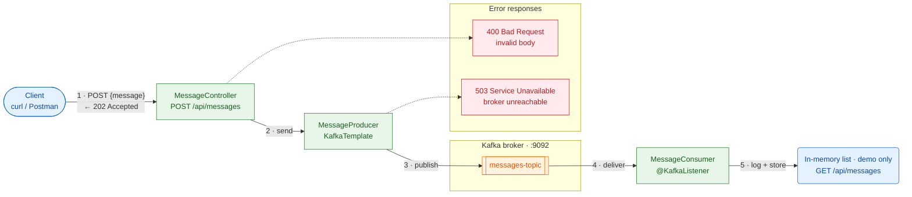

# Kafka Challenge — Spring Boot + Apache Kafka

🌐 **English** · [Português (BR)](README.pt-BR.md)

A Spring Boot application that demonstrates the full messaging flow:



🟩 Spring Boot components (`:8080`) · 🟧 Kafka · 🟥 error responses. Solid arrows are the happy path; dashed arrows are failures.

## Structure

| File | Responsibility |
|---|---|
| `pom.xml` | `spring-boot-starter-web`, `spring-kafka` and `spring-kafka-test` dependencies |
| `src/main/resources/application.yml` | Broker connection, serializers, group-id and topic name |
| `config/KafkaTopicConfig` | Creates the topic on startup (if it does not exist yet) |
| `producer/MessageProducer` | Publishes messages to the topic using `KafkaTemplate` |
| `consumer/MessageConsumer` | Consumes the topic using `@KafkaListener` |
| `controller/MessageController` | REST endpoint that forwards the message to the Producer |
| `controller/ApiExceptionHandler` | Turns Kafka publish failures into `503 Service Unavailable` |
| `docker-compose.yml` | Local Kafka broker (KRaft mode, no Zookeeper) |

## Requirements

- Java 21
- Maven 3.9+
- Docker (to run Kafka)

## Running

1. Start Kafka:
   ```bash
   docker compose up -d
   ```
2. Run the application:
   ```bash
   mvn spring-boot:run
   ```
3. Send a message:
   ```bash
   curl -X POST http://localhost:8080/api/messages -H "Content-Type: application/json" -d '{"message": "Hello, Kafka!"}'
   ```
   Response (`202 Accepted`):
   ```json
   {"status":"PUBLISHED","topic":"messages-topic","partition":0,"offset":0,"message":"Hello, Kafka!"}
   ```
4. Check the consumption:
   - The application log shows `Message published successfully [...]` followed by `Message consumed [...]: Hello, Kafka!`
   - Or list the messages received by the Consumer:
     ```bash
     curl http://localhost:8080/api/messages
     ```

The broker address can be overridden with the `KAFKA_BOOTSTRAP_SERVERS` environment variable (default: `localhost:9092`).

## Tests

```bash
mvn test
```

| Test | What it covers |
|---|---|
| `MessageFlowIntegrationTest` | End to end with embedded Kafka (`@EmbeddedKafka`): messages go through the endpoint, are consumed in order and arrive unchanged (accents/emoji included) — no Docker needed |
| `MessageControllerTest` | Invalid requests return `400` without publishing; a Kafka failure returns `503` |
| `MessageProducerTest` | The message is sent to the configured topic |
| `MessageConsumerTest` | Consumed messages are stored and exposed as read-only |

If the broker is unreachable, the producer gives up after 5 seconds (`max.block.ms`) and the endpoint returns `503 Service Unavailable`.
