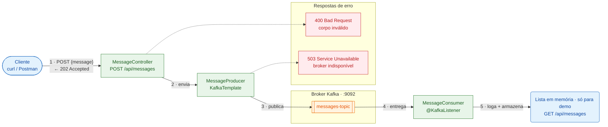

# Kafka Challenge — Spring Boot + Apache Kafka

🌐 [English](README.md) · **Português (BR)**

Aplicação Spring Boot que demonstra o fluxo completo de mensageria:



🟩 Componentes Spring Boot (`:8080`) · 🟧 Kafka · 🟥 respostas de erro. Setas contínuas são o fluxo de sucesso; setas tracejadas são falhas.

## Estrutura

| Arquivo | Responsabilidade |
|---|---|
| `pom.xml` | Dependências `spring-boot-starter-web`, `spring-kafka` e `spring-kafka-test` |
| `src/main/resources/application.yml` | Conexão com o broker, serializers, group-id e nome do tópico |
| `config/KafkaTopicConfig` | Cria o tópico na inicialização (se ainda não existir) |
| `producer/MessageProducer` | Publica mensagens no tópico usando `KafkaTemplate` |
| `consumer/MessageConsumer` | Consome o tópico usando `@KafkaListener` |
| `controller/MessageController` | Endpoint REST que repassa a mensagem ao Producer |
| `controller/ApiExceptionHandler` | Converte falhas de publicação no Kafka em `503 Service Unavailable` |
| `docker-compose.yml` | Broker Kafka local (modo KRaft, sem Zookeeper) |

## Pré-requisitos

- Java 21
- Maven 3.9+
- Docker (para rodar o Kafka)

## Como executar

1. Suba o Kafka:
   ```bash
   docker compose up -d
   ```
2. Rode a aplicação:
   ```bash
   mvn spring-boot:run
   ```
3. Envie uma mensagem:
   ```bash
   curl -X POST http://localhost:8080/api/messages -H "Content-Type: application/json" -d '{"message": "Olá, Kafka!"}'
   ```
   Resposta (`202 Accepted`):
   ```json
   {"status":"PUBLISHED","topic":"messages-topic","partition":0,"offset":0,"message":"Olá, Kafka!"}
   ```
4. Confira o consumo:
   - O log da aplicação mostra `Message published successfully [...]` seguido de `Message consumed [...]: Olá, Kafka!`
   - Ou liste as mensagens recebidas pelo Consumer:
     ```bash
     curl http://localhost:8080/api/messages
     ```

O endereço do broker pode ser alterado pela variável de ambiente `KAFKA_BOOTSTRAP_SERVERS` (padrão: `localhost:9092`).

## Testes

```bash
mvn test
```

| Teste | O que cobre |
|---|---|
| `MessageFlowIntegrationTest` | Ponta a ponta com Kafka embarcado (`@EmbeddedKafka`): as mensagens passam pelo endpoint, são consumidas na ordem e chegam inalteradas (incluindo acentos/emoji) — sem precisar de Docker |
| `MessageControllerTest` | Requisições inválidas retornam `400` sem publicar nada; uma falha no Kafka retorna `503` |
| `MessageProducerTest` | A mensagem é enviada para o tópico configurado |
| `MessageConsumerTest` | As mensagens consumidas são armazenadas e expostas somente para leitura |

Se o broker estiver indisponível, o producer desiste após 5 segundos (`max.block.ms`) e o endpoint retorna `503 Service Unavailable`.
